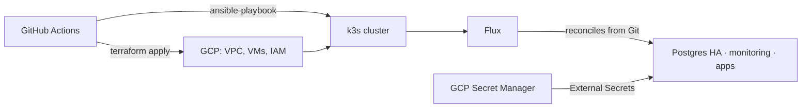

## 👋 George Agriogiannis

**Linux & Cloud Infrastructure Engineer · SRE · DevOps · Kubernetes** — Prague, Czechia

Infrastructure engineer with 14 years across Linux engineering, site reliability, DevOps and enterprise support at SUSE, Thales, Red Hat, Oracle and AT&T. I build and run cloud infrastructure with Terraform, Kubernetes and GitOps pipelines on AWS and GCP, and I troubleshoot production issues down to the OS and network layer.

### 🚀 Featured work

- **[gitops-platform](https://github.com/Gagrio/gitops-platform)** — GitOps platform on GCP: Terraform, Ansible-bootstrapped k3s and Flux, with CloudNativePG Postgres HA, External Secrets and Workload Identity Federation, deployed and verified through GitHub Actions.
- **[condash](https://github.com/Gagrio/condash)** — Rust CLI that spins up temporary Prometheus/Grafana monitoring for any container; released for Linux and macOS via Homebrew and openSUSE packages.
- **[ketchup](https://github.com/Gagrio/ketchup)** — Rust tool that collects and archives Kubernetes cluster configuration for troubleshooting.
- **[pack](https://github.com/Gagrio/pack)** and **[nessie](https://github.com/Gagrio/nessie)** — diagnostic tools for host path and log collection, contributed to the official [SUSE Edge support-tools](https://github.com/suse-edge/support-tools) repository.

#### How gitops-platform fits together

### 🛠️ Tools I work with

<table>
  <tr>
    <td><b>📦 Containers & orchestration</b></td>
    <td> Kubernetes &nbsp;·&nbsp;  Docker &nbsp;·&nbsp;  Helm &nbsp;·&nbsp;  Rancher &nbsp;·&nbsp;  K3s / RKE2 &nbsp;·&nbsp;  Podman &nbsp;·&nbsp;  SUSE Edge (Metal3, Elemental, SUSE Linux Micro)</td>
  </tr>
  <tr>
    <td><b>☁️ Cloud & IaC</b></td>
    <td> AWS &nbsp;·&nbsp;  Terraform &nbsp;·&nbsp;  Google Cloud</td>
  </tr>
  <tr>
    <td><b>🔁 GitOps & CI/CD</b></td>
    <td> Git &nbsp;·&nbsp;  GitHub Actions &nbsp;·&nbsp;  GitLab CI &nbsp;·&nbsp;  Flux</td>
  </tr>
  <tr>
    <td><b>🐧 Linux & Unix</b></td>
    <td> Red Hat Enterprise Linux &nbsp;·&nbsp;  Ubuntu &nbsp;·&nbsp;  Debian &nbsp;·&nbsp;  SUSE Linux Enterprise / openSUSE &nbsp;·&nbsp;  Oracle Linux &nbsp;·&nbsp; Solaris &nbsp;·&nbsp; AIX</td>
  </tr>
  <tr>
    <td><b>⚙️ Configuration management</b></td>
    <td> Ansible &nbsp;·&nbsp;  Chef &nbsp;·&nbsp;  SaltStack</td>
  </tr>
  <tr>
    <td><b>📈 Observability</b></td>
    <td> Prometheus &nbsp;·&nbsp;  Grafana &nbsp;·&nbsp;  Datadog &nbsp;·&nbsp;  ELK / EFK</td>
  </tr>
  <tr>
    <td><b>🌐 Networking</b></td>
    <td>TCP/IP &nbsp;·&nbsp; DNS &nbsp;·&nbsp; DHCP &nbsp;·&nbsp; load balancing ( nginx, Kubernetes Ingress, cloud load balancers) &nbsp;·&nbsp; Linux firewalling (netfilter) and cloud firewall rules &nbsp;·&nbsp;  tcpdump / Wireshark &nbsp;·&nbsp; RADIUS</td>
  </tr>
  <tr>
    <td><b>💻 Scripting</b></td>
    <td> Bash &nbsp;·&nbsp;  Python</td>
  </tr>
  <tr>
    <td><b>🗄️ Databases</b></td>
    <td> PostgreSQL (CloudNativePG) &nbsp;·&nbsp;  Oracle Database</td>
  </tr>
  <tr>
    <td><b>🔐 Identity & security</b></td>
    <td> Red Hat Identity Management (FreeIPA) &nbsp;·&nbsp; Kerberos &nbsp;·&nbsp; Samba &nbsp;·&nbsp; SSSD &nbsp;·&nbsp; Red Hat Directory Server / 389 DS &nbsp;·&nbsp; PAM &nbsp;·&nbsp; OS hardening</td>
  </tr>
  <tr>
    <td><b>🏗️ Build & packaging</b></td>
    <td> Container images &nbsp;·&nbsp; RPM packaging &nbsp;·&nbsp;  Open Build Service (OBS)</td>
  </tr>
</table>

### 📫 Contact

[LinkedIn](https://www.linkedin.com/in/gagriogiannis/)
