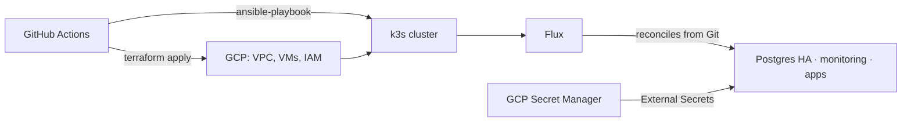

## 👋 George Agriogiannis

**Linux & Cloud Infrastructure Engineer · SRE · DevOps · Kubernetes** — Prague, Czechia

Infrastructure engineer with 14 years across Linux engineering, site reliability, DevOps and enterprise support at SUSE, Thales, Red Hat, Oracle and AT&T. I build and run cloud infrastructure with Terraform, Kubernetes and GitOps pipelines on AWS and GCP, and I troubleshoot production issues down to the OS and network layer.

### 🚀 Featured work

- **[gitops-platform](https://github.com/Gagrio/gitops-platform)** — GitOps platform on GCP: Terraform, Ansible-bootstrapped k3s and Flux, with CloudNativePG Postgres HA, External Secrets and Workload Identity Federation, deployed and verified through GitHub Actions.
- **[condash](https://github.com/Gagrio/condash)** — Rust CLI that spins up temporary Prometheus/Grafana monitoring for any container; released for Linux and macOS via Homebrew and openSUSE packages.
- **[ketchup](https://github.com/Gagrio/ketchup)** — Rust tool that collects and archives Kubernetes cluster configuration for troubleshooting.
- **[pack](https://github.com/Gagrio/pack)** and **[nessie](https://github.com/Gagrio/nessie)** — diagnostic tools for host path and log collection, contributed to the official [SUSE Edge support-tools](https://github.com/suse-edge/support-tools) repository.

#### How gitops-platform fits together

### 🛠️ Tools I work with

- **Cloud & IaC:** AWS, GCP, Terraform
- **Containers & GitOps:** Kubernetes, Helm, Flux, Docker, RKE2/K3s, Rancher
- **CI/CD & packaging:** GitLab CI, GitHub Actions, Jenkins, Open Build Service
- **Configuration management:** Ansible, SaltStack, Puppet
- **Linux & networking:** SLES/openSUSE, RHEL, Debian/Ubuntu; TCP/IP, DNS, DHCP, load balancing
- **Observability:** Prometheus, Grafana, ELK

### 📫 Contact

[LinkedIn](https://www.linkedin.com/in/gagriogiannis/)
